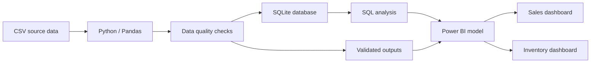

# Sales & Inventory Analytics
### End-to-end Business Intelligence portfolio project

[](https://www.python.org/)
[](https://www.sqlite.org/)
[](https://powerbi.microsoft.com/)

A portfolio project demonstrating an end-to-end analytics workflow: data validation with **Python**, business analysis with **SQL**, and decision-oriented reporting with **Power BI**.

> **Data disclaimer:** all datasets are synthetic and created for demonstration purposes. Figures below are outputs from this dataset; they do not represent the performance of a real company.

## Business questions

- How do revenue, units sold and gross margin evolve over time?
- Which products, categories and sites contribute most to revenue?
- What is the stock position at the latest available date?
- Which product-site combinations are out of stock?
- Can key aggregates be reconciled across Python and SQL?

## Dashboard preview

### Commercial performance


### Inventory monitoring


The Power BI report is available as a [PDF export](powerbi/Sales%20%26%20Inventory%20Analytics%20pdf.pdf) and as a [Power BI Desktop file (.pbix)](powerbi/Sales%20%26%20Inventory%20Analytics.pbix).

## Key outputs

| Metric | Result |
|---|---:|
| Revenue | €1,467,589.34 |
| Gross margin | €490,454.34 |
| Gross margin rate | 33.4% |
| Sales records | 6,000 |
| Stock records | 26,316 |
| Analysis period | January 2024 – December 2025 |

These figures are calculated from the committed synthetic dataset. The gross margin rate is gross margin divided by revenue.

## Technical workflow



### 1. Data preparation and validation — Python

The script in `python/analyse.py`:
- Loads the CSV files from `data/`.
- Checks uniqueness of sales line identifiers and stock snapshot keys.
- Checks referential integrity against product, site and date dimensions.
- Checks positive sales quantities, non-negative stock and revenue arithmetic.
- Loads the data into an in-memory SQLite database and reconciles total revenue.
- Exports monthly revenue and a validation summary to `results/`.

### 2. Business analysis — SQL

The queries in [sql/analyses.sql](sql/analyses.sql) cover:
- Revenue and units sold.
- Monthly revenue trends.
- Revenue by site and product.
- Gross margin by category.
- Top products.
- Previous-month comparison using `LAG()`.
- Product ranking by site using `DENSE_RANK()`.
- Cumulative revenue using window functions.
- Latest-date stock and out-of-stock counts.

### 3. Data modeling and reporting — Power BI

The report uses separate sales and inventory fact tables with shared dimensions.

| Table | Role | Expected grain |
|---|---|---|
| `fact_sales` | Sales transactions | One row per sales line |
| `fact_stock` | Inventory snapshots | One row per date, product and site |
| `dim_date` | Calendar attributes | One row per date |
| `dim_product` | Product attributes | One row per product |
| `dim_site` | Site attributes | One row per site |

Core DAX measures are documented in [powerbi/mesures.dax](powerbi/mesures.dax). The latest-stock measures use the latest date in the current date-filter context; interpret them accordingly.

## Repository structure

```text
.
├── data/                 # Synthetic CSV source data
├── python/
│   └── analyse.py        # Validation and output generation
├── sql/
│   └── analyses.sql      # Business analysis queries
├── powerbi/
│   ├── Sales & Inventory Analytics.pbix
│   ├── Sales & Inventory Analytics pdf.pdf
│   └── mesures.dax
├── Screenshots/          # Dashboard previews
├── results/              # Generated CSV outputs
├── requirements.txt
└── README.md
```

## Run locally

Requirements: Python 3.10 or newer.

```bash
git clone https://github.com/thierry-mhz/Projet_Portfolio_Sales_Stocks.git
cd Projet_Portfolio_Sales_Stocks

python -m venv .venv
# Windows: .venv\Scripts\activate
# macOS / Linux:
source .venv/bin/activate

pip install -r requirements.txt
python python/analyse.py
```

The script regenerates `results/monthly_revenue.csv` and `results/validation_summary.csv`.

The SQL queries can be run against a SQLite database populated from the CSV files. The Power BI report can be opened with Power BI Desktop.

## Assumptions and limitations

- The dataset is synthetic; results are illustrative, not operational KPIs.
- Inventory is a snapshot-based measure, not a real-time stock feed.
- The SQL query for the latest stock date uses the latest date across the full dataset. If sites have different snapshot dates, a per-site latest-date rule may be more appropriate.
- The current Python script uses assertions for validation. For production use, replace them with explicit validation exceptions, structured logging and automated tests.
- The project does not currently demonstrate scheduled refresh or production deployment.

## Potential next steps

- Add automated unit tests with `pytest` and a CI workflow.
- Add a documented data dictionary and business definitions for each KPI.
- Add a per-site latest-stock-date analysis and stock ageing / turnover metrics.
- Improve exception handling and logging in the Python pipeline.
- Document the Power BI relationship diagram and filter behavior.

## Author

**Thierry Muhoza Banyangiriki**  
Business Data Analyst | Business Intelligence & Performance Analytics

[LinkedIn](https://linkedin.com/in/muhoza-banyangiriki) · [GitHub profile](https://github.com/thierry-mhz)
